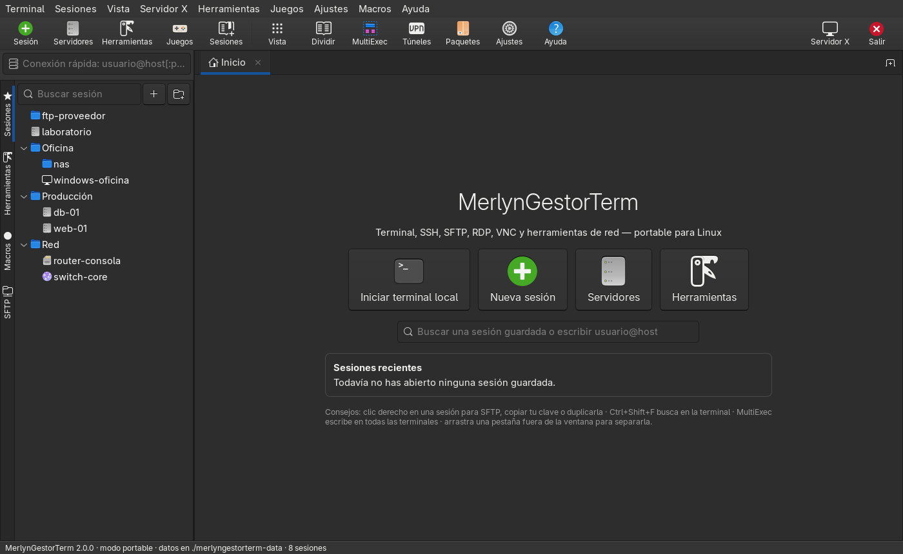
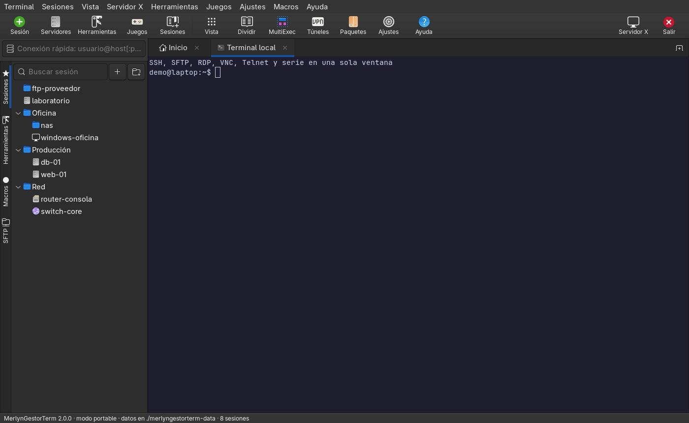
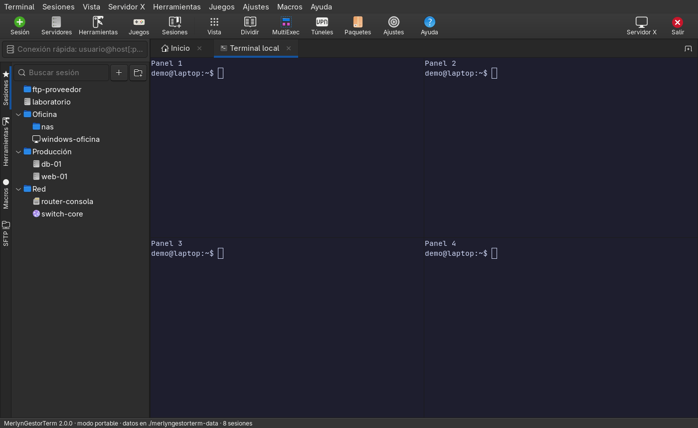
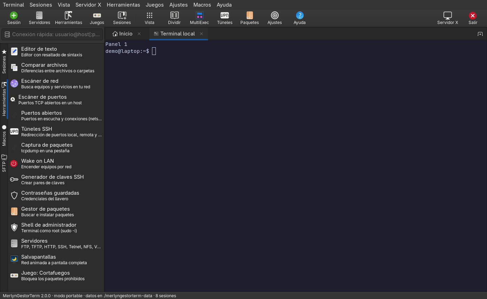
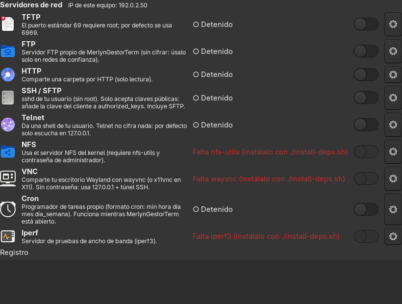
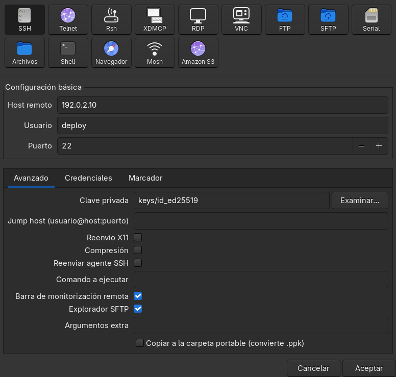

# MerlynGestorTerm

Terminal portable para Linux con sesiones SSH, SFTP, RDP, VNC, Telnet, serie y FTP, explorador de
archivos remoto, servidores integrados y herramientas de red, todo en una sola ventana.

[](../../actions/workflows/ci.yml)




> **Aviso:** MerlynGestorTerm es un proyecto independiente. Su organización de la interfaz está
> inspirada en MobaXterm, pero **no está afiliado, patrocinado ni respaldado por Mobatek**, y no
> contiene código, gráficos ni archivos de MobaXterm. «MobaXterm» es una marca de sus respectivos
> propietarios; aquí solo se menciona para describir la compatibilidad con su archivo `MobaXterm.ini`.

## Instalación

```bash
git clone https://github.com/<tu-usuario>/MerlynGestorTerm.git
cd MerlynGestorTerm
./install-deps.sh --escritorio   # instala dependencias y crea el acceso directo en el menú
./merlyngestorterm
```

`install-deps.sh` detecta la distribución e instala los paquetes correctos:

| Familia | Distribuciones |
|---|---|
| Debian | Debian, Ubuntu, Linux Mint, Pop!_OS, elementary, Zorin, Kali, Raspberry Pi OS |
| Arch | Arch, Manjaro, EndeavourOS, Omarchy, Garuda, CachyOS, Artix |
| Fedora | Fedora, Nobara, RHEL, Rocky, AlmaLinux (los opcionales necesitan EPEL) |

```bash
./install-deps.sh               # todo: imprescindible + opcional
./install-deps.sh --minimo      # solo lo imprescindible (terminal, SSH, SFTP, FTP, herramientas)
./install-deps.sh --comprobar   # qué está instalado y qué falta
./install-deps.sh --simular     # muestra los comandos sin ejecutar nada
./install-deps.sh --ayuda       # todas las opciones
```

También puedes descargar el `.tar.gz` de la [última versión](../../releases/latest).

**Portable:** copia la carpeta a un USB u otro equipo. Sesiones, ajustes, túneles, macros, claves
copiadas y registros se guardan en `./merlyngestorterm-data/` (o en `$MERLYN_HOME`).

## Capturas

| Sesiones y terminal | Cuatro terminales en una pestaña |
|---|---|
|  |  |
| **Herramientas** | **Servidores integrados** |
|  |  |



## Tipos de sesión

| Tipo | Cómo funciona |
|---|---|
| SSH | terminal + explorador SFTP lateral + barra de monitorización (CPU, RAM, disco, red) |
| Telnet / Rsh | cliente del sistema |
| XDMCP | escritorio remoto en una ventana Xephyr |
| RDP | FreeRDP |
| VNC | TigerVNC o Remmina |
| FTP / FTPS | explorador de archivos propio |
| SFTP | explorador + consola sftp |
| Serie | picocom, screen o minicom |
| Archivos | explorador de archivos local |
| Shell | terminal local o comando |
| Navegador | abre la URL en tu navegador |
| Mosh | cliente mosh |
| Amazon S3 | explorador de buckets (también MinIO u otro S3 con URL de endpoint) |

Puedes **importar tus sesiones de `MobaXterm.ini`** desde el menú Sesiones (SSH, Telnet, Rsh, RDP,
VNC, FTP, SFTP y navegador, con sus carpetas). Las contraseñas de MobaXterm no se importan porque
están cifradas con su contraseña maestra.

## Funciones

**Terminal:** pestañas reordenables y separables, división en 2 o 4 paneles, MultiExec (escribir en
todas las terminales a la vez), búsqueda, zoom, copiar al seleccionar, guardar la salida, registro de
sesiones y reconexión con `R`.

**Explorador de archivos (SFTP, FTP, S3, local):** subir (también arrastrando), descargar carpetas,
crear, renombrar, cambiar permisos, borrar y **editar**: el archivo se abre en el editor integrado y se
vuelve a subir al guardar. En SSH reutiliza la conexión de la terminal sin volver a autenticarse.

**Servidores:** TFTP, FTP, HTTP, SSH/SFTP, Telnet, NFS, VNC, Cron e Iperf. FTP, TFTP, Telnet y Cron
están implementados en el propio programa; el resto usa los programas del sistema.

**Herramientas:** editor de texto con resaltado · comparador de archivos y carpetas · escáner de red
(ping, puertos, DNS, MAC y fabricante) · escáner de puertos · puertos abiertos y conexiones · túneles
SSH (-L, -R y SOCKS, con autoinicio) · captura de paquetes · Wake on LAN · generador de claves SSH ·
gestor de contraseñas · gestor de paquetes (apt/pacman/dnf vía terminal) · shell de administrador ·
macros · salvapantallas · el juego original «Cortafuegos».

## Contraseñas y claves

- Las contraseñas y passphrases se guardan **cifradas en el llavero del sistema** (GNOME Keyring o
  KWallet), nunca en los archivos del programa. ssh las recibe mediante `SSH_ASKPASS`.
- El llavero pertenece a cada equipo: si llevas la carpeta a otro PC, tendrás que volver a escribirlas.
- «Copiar a la carpeta portable» guarda la clave en `merlyngestorterm-data/keys/` con permisos `600`;
  las claves `.ppk` de PuTTY/MobaXterm se convierten a OpenSSH.
- Clic derecho en una sesión SSH → **Instalar mi clave en el servidor** para no volver a usar contraseña.

Lee [SECURITY.md](SECURITY.md) antes de usar los servidores integrados: FTP, TFTP y Telnet no cifran.

## Atajos de teclado

| Atajo | Acción |
|---|---|
| Ctrl+Shift+T | nueva terminal local |
| Ctrl+Shift+N | nueva sesión |
| Ctrl+Shift+W | cerrar pestaña |
| Ctrl+RePág / AvPág | cambiar de pestaña |
| Ctrl+Shift+D / E | dividir en vertical / horizontal |
| Ctrl+Shift+M | MultiExec |
| Ctrl+Shift+F | buscar en la terminal |
| Ctrl+Shift+C / V | copiar / pegar |
| Ctrl + / − / 0 | zoom |
| F11 | pantalla completa |

## Desarrollo

```bash
python3 tests/smoke_test.py          # pruebas funcionales sin interfaz
ruff check --select F,E9 .           # errores de Python
shellcheck -S warning install-deps.sh merlyngestorterm merlyngestorterm-askpass
```

La integración continua ejecuta lo anterior e instala el programa con `install-deps.sh` en Debian 12,
Ubuntu 24.04, Fedora 41 y Arch Linux. Para publicar una versión, actualiza `VERSION` en `core.py` y
sube una etiqueta `vX.Y.Z`: GitHub Actions crea la release con el `.tar.gz` y su SHA-256.

| Archivo | Contenido |
|---|---|
| `merlyngestorterm` | lanzador |
| `merlyngestorterm.py` | punto de entrada |
| `core.py` | datos, llavero, claves y comandos de cada tipo de sesión |
| `window.py` | ventana principal, diálogo de sesión y ajustes |
| `terminal.py` | terminales, división y monitorización remota |
| `browser.py` | explorador de archivos (SFTP, FTP, S3, local) |
| `tools.py` | herramientas |
| `servers.py` | servidores integrados |
| `games.py` | juego «Cortafuegos» |
| `install-deps.sh` | instalador de dependencias |

## Licencia

[MIT](LICENSE). Usa GTK, VTE y PyGObject (LGPL) como bibliotecas del sistema.
